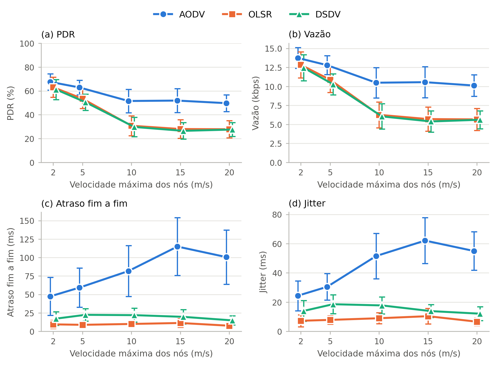

# manet-ns3-roteamento

Repositório acadêmico da atividade avaliativa: um experimento com o simulador **ns-3** para avaliar o
impacto da **mobilidade** no desempenho dos protocolos de roteamento **AODV**, **OLSR** e **DSDV** em
uma Mobile Ad Hoc Network (MANET).

- **Métricas:** vazão (throughput), Packet Delivery Ratio (PDR), atraso fim a fim e jitter.
- **Fator variado:** velocidade máxima dos nós (modelo Random Waypoint, pausa fixa em 0 s).
- **Repositório:** https://github.com/AtomicP46/manet-ns3-roteamento

## Grupo

Disciplina de Redes Móveis, IFG Câmpus Inhumas (Prof. Rogério Sousa e Silva).

- Pedro Henrique Portela de Sousa
- <!-- ADICIONAR AQUI os demais integrantes do grupo -->

Os documentos da entrega (artigo no formato SBC e slides) estão em [`documents/`](documents/).

## Resultados



Média de 10 sementes por ponto, com intervalo de confiança de 95%. Os valores numéricos estão em
[`data/resumo.csv`](data/resumo.csv) e os dados de cada simulação em
[`data/resultados.csv`](data/resultados.csv).

## Ambiente e versões

| Item | Versão |
|---|---|
| Simulador | ns-3.48 (`ns-allinone-3.48.tar.bz2`, sha1 `62fa2080187dcf2f7de8ccde149575fa1227f859`, publicado em nsnam.org) |
| Sistema (imagem Docker) | Ubuntu 24.04 |
| g++ | 13.3.0 |
| cmake | 3.28.3 |
| Python | 3.12.3 (pandas, matplotlib e scipy do Ubuntu 24.04) |

Tudo roda dentro de um container Docker, o que fixa essas versões em qualquer máquina. O `Dockerfile`
deste repositório instala as dependências e baixa o ns-3.48 oficial, conferindo o checksum.

## Estrutura do repositório

```
manet-ns3-roteamento/
├── README.md
├── Dockerfile
├── scratch/
│   └── manet-exp.cc              # cenário do experimento (derivado do exemplo oficial)
├── scripts/
│   ├── make_manet_exp.py         # gera scratch/manet-exp.cc a partir do exemplo manet-routing-compare.cc
│   ├── run_experiments.py        # roda as simulações em lote e extrai as métricas do FlowMonitor
│   ├── plot.py                   # resumo estatístico (média, IC 95%) e gráficos por métrica
│   ├── estatisticas.py           # estatística descritiva completa (média, desvio, mín., máx., IC 95%, perdas)
│   └── plot_comparativo.py       # gráfico comparativo agregado dos 3 protocolos em uma velocidade
├── data/
│   ├── resultados.csv            # dados brutos: uma linha por simulação (150 linhas)
│   ├── resumo.csv                # média e IC 95% por protocolo e velocidade
│   └── estatisticas.csv          # média, desvio, mín., máx., IC 95% (inclui vazão em Mbps e pacotes perdidos)
├── figures/                      # gráficos (.png e .pdf)
└── documents/                    # artigo (SBC) e slides da apresentação
```

`scratch/manet-exp.cc` é uma cópia de `examples/routing/manet-routing-compare.cc` (ns-3.48) com
quatro parâmetros de linha de comando a mais (`--manetMaxSpeed`, `--manetMinSpeed`, `--manetPause` e
`--manetOutPrefix`). Com os valores padrão, ele se comporta como o exemplo original. O arquivo é
produzido por `scripts/make_manet_exp.py`, que aborta se o exemplo original for diferente do esperado.

## Como reproduzir

Pré-requisitos: [Docker](https://www.docker.com/products/docker-desktop) e Git.

**1. Clonar o repositório e construir a imagem**

```bash
git clone https://github.com/AtomicP46/manet-ns3-roteamento.git
cd manet-ns3-roteamento
docker build -t manet-ns3 .
```

**2. Abrir o container com a pasta do projeto compartilhada em `/work`**

```powershell
# PowerShell (Windows)
docker run -it --name manet -v ${PWD}:/work manet-ns3
```

```bash
# Linux / macOS
docker run -it --name manet -v "$(pwd)":/work manet-ns3
```

Para voltar ao mesmo container depois: `docker start -ai manet`. Os comandos abaixo são executados
**dentro do container**, na pasta do ns-3 (`/ns3/ns-allinone-3.48/ns-3.48`, onde o container já abre).

**3. Compilar o ns-3** (a primeira compilação é demorada, de dezenas de minutos; `-j2` evita
estourar a memória em máquinas com 8 GB de RAM)

```bash
./ns3 configure --enable-examples --enable-tests
./ns3 build -j2
```

**4. Gerar e compilar o cenário do experimento**

```bash
python3 /work/scripts/make_manet_exp.py
./ns3 run "manet-exp --PrintHelp"
```

O segundo comando compila `scratch/manet-exp.cc` na primeira vez e confirma que ele roda.

**5. Teste rápido (1 simulação, cerca de 45 s)**

```bash
python3 /work/scripts/run_experiments.py --protocols AODV --speeds 5 --seeds 1 --out /tmp/smoke.csv
cat /tmp/smoke.csv
```

Resultado esperado (confira se os números batem):

```
AODV,5,1,10,3971,2066,52.027197,10.57792,60.76167,40.920819,<tempo>
```

**6. Experimento completo (150 simulações)**

```bash
python3 /work/scripts/run_experiments.py --jobs 3
```

Cada simulação leva entre ~20 e ~115 s (com 3 em paralelo). O resultado vai para `data/resultados.csv`.
Se for interrompido, rode o mesmo comando de novo: as simulações já gravadas são puladas.
Use `--jobs 1` para executar uma de cada vez.

**7. Resumo estatístico e gráficos**

```bash
python3 /work/scripts/plot.py
```

Gera `data/resumo.csv` e os arquivos em `figures/` (um gráfico por métrica, com a velocidade no eixo x,
e `resumo_2x2`).

**8. Estatística descritiva completa e gráfico comparativo**

```bash
python3 /work/scripts/estatisticas.py
python3 /work/scripts/plot_comparativo.py --speed 10
```

O primeiro grava `data/estatisticas.csv` (por protocolo, velocidade e métrica: `n`, `mean`, `std`, `min`,
`max`, `ci95`; métricas: PDR, vazão em Mbps, atraso, jitter, pacotes recebidos e pacotes perdidos). O
segundo grava `figures/comparativo_10ms.(png|pdf)`: barras dos três protocolos, com IC 95%, na
velocidade escolhida em `--speed` (2, 5, 10, 15 ou 20).

Os scripts de análise só leem `data/resultados.csv`; para conferir os resultados **não é preciso
rodar o ns-3**. Basta Python 3 com pandas, matplotlib e scipy.

**Execução direta de uma configuração** (é exatamente o que o `run_experiments.py` executa para cada
simulação; aqui, AODV, velocidade máxima 10 m/s, semente 3, dentro da pasta do ns-3):

```bash
./ns3 run --no-build "manet-exp --protocol=AODV --manetMaxSpeed=10 --manetMinSpeed=1 --manetPause=0 --RngRun=3 --traceMobility=false --flowMonitor=true --manetOutPrefix=/tmp/AODV_v10_s3 --CSVfileName=/tmp/AODV_v10_s3.csv"
python3 /work/scripts/run_experiments.py --parse-only /tmp/AODV_v10_s3.flowmon
```

O primeiro comando gera `/tmp/AODV_v10_s3.flowmon` (saída do FlowMonitor); o segundo extrai dele as
métricas. As demais opções do exemplo aparecem em `./ns3 run "manet-exp --PrintHelp"`.

## Parâmetros do experimento

| Parâmetro | Valor |
|---|---|
| Protocolos | AODV, OLSR, DSDV (implementações do ns-3.48) |
| Mobilidade | Random Waypoint; velocidade sorteada entre 1 m/s e a velocidade máxima; pausa 0 s |
| **Velocidade máxima (fator variado)** | **2, 5, 10, 15 e 20 m/s** |
| Número de nós | 50 |
| Área | 300 m × 1500 m |
| Duração | 200 s (tráfego de dados de ~100 s até 200 s; os primeiros 100 s são de aquecimento) |
| Tráfego | 10 pares origem/destino, UDP com taxa constante de 2048 bps (4 pacotes/s de 64 bytes) |
| Camada física/MAC | Wi-Fi 802.11b ad hoc, 11 Mb/s (DsssRate11Mbps), perda de Friis, potência de transmissão 7,5 dBm |
| Sementes | `RngRun` de 1 a 10 (as mesmas para os três protocolos) |
| Repetições | 3 protocolos × 5 velocidades × 10 sementes = **150 simulações** |

Exceto a velocidade, os valores são os padrão do exemplo `manet-routing-compare` do ns-3.48. O exemplo
atribui fluxos de números aleatórios fixos à mobilidade, para que ela seja consistente entre cenários.

## Métricas

Calculadas por simulação a partir do arquivo do FlowMonitor, considerando **apenas os fluxos de dados**
(UDP, porta de destino 9); o tráfego de controle dos protocolos de roteamento é ignorado.

| Métrica | Definição |
|---|---|
| PDR (%) | pacotes recebidos ÷ pacotes oferecidos × 100 |
| Vazão (kbps) | pacotes recebidos × 64 B × 8 ÷ 100 s ÷ 1000 (100 s = janela nominal de tráfego) |
| Atraso fim a fim (ms) | soma dos atrasos ÷ pacotes recebidos |
| Jitter (ms) | soma dos jitters ÷ (pacotes recebidos − 1) |

O resumo (`data/resumo.csv`) traz a média e o intervalo de confiança de 95% sobre as 10 sementes:
média ± t(0,975; n−1) × desvio padrão ÷ √n.

### Atenção: como o PDR é calculado

O FlowMonitor só conta como "enviado" o pacote que chega à camada IP. No **OLSR**, o número de
pacotes enviados contados é bem menor que nos outros protocolos (média de cerca de 2756 por
simulação, contra cerca de 3974 em AODV e DSDV), embora a aplicação gere a mesma carga. A explicação
provável é que, sem rota para o destino, o pacote é descartado no socket, antes da camada IP, e nunca
é contado como enviado. Usar `pdr_percent` ou `tx_packets` do CSV tornaria o PDR do OLSR
artificialmente alto. Por isso `plot.py` calcula **PDR = `rx_packets` ÷ pacotes oferecidos**, onde pacotes oferecidos é a
mediana de `tx_packets` de AODV e DSDV (3974 por simulação), protocolos em que o FlowMonitor
contou todos os pacotes. Vazão, atraso e jitter dependem só de pacotes recebidos e não são afetados.

Em 10 simulações de OLSR, o FlowMonitor não registrou nenhum pacote de uma das fontes, provavelmente
porque ela ficou sem rota durante toda a simulação (`data_flows` menor que 10 no CSV). Essas
simulações foram mantidas na análise; o PDR delas conta os pacotes desse fluxo como perdidos.

## Dicionário de dados

`data/resultados.csv` (gerado por `run_experiments.py`):

| Coluna | Significado |
|---|---|
| `protocol` | AODV, OLSR ou DSDV |
| `max_speed_mps` | velocidade máxima dos nós (m/s) |
| `seed` | valor de `RngRun` |
| `data_flows` | fluxos de dados encontrados no FlowMonitor (esperado: 10) |
| `tx_packets`, `rx_packets` | pacotes enviados (visto pelo FlowMonitor na camada IP) e recebidos |
| `pdr_percent` | PDR calculado com `tx_packets`. **Não usar para o OLSR** (ver acima) |
| `throughput_kbps` | vazão agregada dos fluxos de dados |
| `avg_delay_ms`, `avg_jitter_ms` | atraso e jitter médios |
| `wall_seconds` | tempo de relógio da simulação |

`data/resumo.csv` (gerado por `plot.py`): para cada protocolo e velocidade, `n`, e a média (`_mean`) e a
metade do intervalo de confiança de 95% (`_ci95`) de `pdr` (corrigido), `throughput_kbps`,
`avg_delay_ms`, `avg_jitter_ms` e `pdr_flowmonitor` (PDR ingênuo, só para comparação).

## Diferenças em relação ao enunciado (transparência)

O enunciado da atividade define um cenário-base e pede que mudanças relevantes sejam registradas e
justificadas. O experimento executado **não** seguiu esse cenário-base; as diferenças são estas:

| Item | Enunciado (cenário-base) | Este experimento |
|---|---|---|
| Nós | 20 | 50 |
| Área | 500 m × 500 m | 300 m × 1500 m |
| Duração | 120 s | 200 s (tráfego a partir de ~100 s) |
| Tráfego | 4 fluxos, pacotes de 1024 B | 10 fluxos, pacotes de 64 B a 4 pacotes/s |
| Velocidades | 1, 5, 10 e 20 m/s | máx. de 2, 5, 10, 15 e 20 m/s (sorteio em U[1, máx.]) |
| Sementes | pelo menos 5 | 10 (`RngRun` 1 a 10) |
| Variável experimental adicional | uma (ex.: tempo de pausa, nº de nós, taxa de tráfego) | **não houve**: a pausa ficou fixa em 0 s |

Justificativa: partimos dos valores padrão do exemplo `manet-routing-compare` do ns-3.48 (50 nós,
300 × 1500 m, 10 fluxos de 64 B, 200 s), que é o cenário de referência do próprio simulador, e
variamos apenas a velocidade máxima. Reconhecemos que isso se afasta do cenário-base pedido e que
o experimento não inclui a variável adicional; esse é o principal limite deste trabalho.

Para uma extensão futura, o cenário já aceita `--manetPause` (tempo de pausa do Random Waypoint, em
segundos), mas **nenhum resultado deste repositório foi obtido com pausa diferente de 0**.

Outras observações sobre o enunciado:

- **Vazão:** `data/resultados.csv` guarda a vazão em kbps. Em Mbps ela está em `data/estatisticas.csv`
  (métrica `throughput_mbps`). Com 2 kbps por fluxo, os valores são da ordem de 0,01 a 0,02 Mbps.
- **Pacotes perdidos:** não há coluna no CSV bruto; ficam em `data/estatisticas.csv` (métrica
  `lost_packets` = pacotes oferecidos − recebidos).
- **Estatística:** `data/estatisticas.csv` traz média, desvio padrão, mínimo, máximo e IC 95%.
- **Gráfico comparativo agregado:** `scripts/plot_comparativo.py`.

## Checklist de reprodutibilidade

| Item exigido | Onde está |
|---|---|
| Código-fonte das simulações | `scratch/manet-exp.cc` (gerado por `scripts/make_manet_exp.py`) |
| README com descrição, preparação, compilação e execução | este arquivo, seções "Como reproduzir" |
| Versão do ns-3 e dependências | "Ambiente e versões" e `Dockerfile` |
| Comandos exatos de execução | "Como reproduzir", passos 3 a 8 |
| Parâmetros e valores | "Parâmetros do experimento" |
| Sementes | `RngRun` 1 a 10 (`SEEDS` em `scripts/run_experiments.py`) |
| Processamento, estatística e gráficos | `scripts/plot.py`, `scripts/estatisticas.py`, `scripts/plot_comparativo.py` |
| Dados brutos / CSV | `data/resultados.csv` (150 simulações), `data/resumo.csv`, `data/estatisticas.csv` |
| Estrutura de diretórios | "Estrutura do repositório" |

## Limitações

- Não há variável experimental adicional além da velocidade (ver seção acima).
- Um único cenário (50 nós, 300 × 1500 m, carga baixa de 2 kbps por fluxo, 802.11b): os resultados não
  devem ser generalizados para outras densidades, cargas ou camadas físicas.
- Com a carga fixa e baixa, a vazão acompanha o PDR.
- Atraso e jitter são calculados só sobre os pacotes entregues.
- O DSR não foi avaliado (a atividade pede AODV, OLSR e DSDV, e o exemplo não permite FlowMonitor com DSR).
